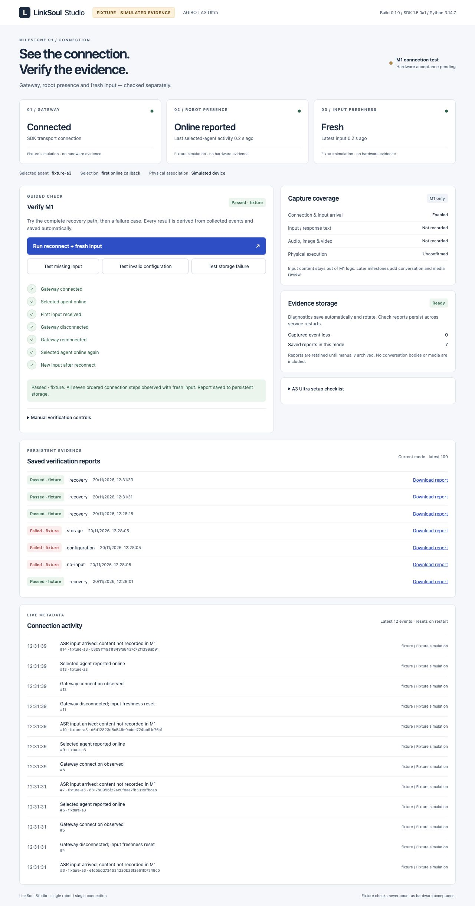

# M1 fixture verification — 2026-11-20

Implementation ready for hardware verification; release acceptance pending. The user requested fixture-first work because robot setup is not configured.

## Executed checks

- `.venv/bin/pytest -q`: **16 passed** in 2.53 seconds. One Starlette/AnyIO BlockingPortal deprecation warning, no failures.
- `docker compose config --quiet`: passed.
- `docker compose up --build -d`: image built successfully; initial startup failed because host port 8000 was occupied. No existing service was removed.
- `STUDIO_PORT=8001 docker compose up -d`: started successfully, `/health` ready=true, fixture mode. Docker reports healthy.
- Browser at localhost:8001: recovery produced Passed with all seven steps and saved report; missing-input check failed with final step incomplete and input waiting; configuration and isolated actual storage-write failures produced Failed with readable recovery. Recovery cleared simulated incident. Enter activated recovery. Desktop 1280×900 and narrow 390×844 layouts inspected; DOM width/scrollWidth both 390 at narrow size. Default viewport restored. No comprehensive accessibility audit performed.
- `STUDIO_PORT=8001 docker compose up -d --force-recreate`: passed. Five existing report hashes stayed identical; app log grew from 8166 to 8309 bytes. Browser reopened all five reports, live state reset to disconnected/unknown/waiting; a new recovery succeeded.

## Build record

Studio 0.1.0; Python 3.14.7; SDK 1.5.0a1; uv 0.12.9; Docker Engine 29.6.2; Compose 5.3.1; Linux arm64 image on macOS arm64. Locked dependency versions/download hashes are in `uv.lock`.

Built image ID: `sha256:3daab9ef326368ed325daa71e7bcd7bce1bb2de70ff11072aba3afefd4923f03`.
Python base digest: `sha256:51dafde81dbdb6ebde285137a295cf18a47ca95234fe388a343719cb97305b3d`.
uv base digest: `sha256:8b940d3a9d65bed080436972241af2e21c84b5e8c9193f7014ed71479ee795ff`.

## Persistent fixture evidence

Volume `linksoul-studio-v2-data`, directory `/data/verification/fixture/`. Reports below were compared before and after recreation:

| Report | Scenario | SHA-256 |
| --- | --- | --- |
| bcf55c95ed3b4e2893aed01515dceae7 | Recovery Passed | e4189e7e36632f397c129a82e263bbcf85a5d35992fa685e0959ea0807ba406e |
| c75212986c474b2995292733a55b7fd0 | Missing input Failed | 75deea4c5965ed16ad467e9d86e83e5014aa5df6d61655ff329a1bd4bd59bc8d |
| 606b29017f05488789ebb89facd9f3e8 | Configuration Failed | c667d86020103449605f6a02fa056064b24789adeda2e623f4d013a7054cbae5 |
| 9ba79eb4034240feb7b5bbb8768965e8 | Storage Failed | 69b3f2fc3ea4c0486d9062a57af1ad24a87a2d854351cd4bd704ed7fc147fd1c |
| 1b4053523cc04458bddaaec5f50f719f | Recovery Passed | 39d2b14f22e6856f4659506fc1c73be005b4173563079f26ba57a792a59913a0 |

## Pending and limits

Real authentication/TLS handshake, actual callbacks/reconnect and physical A3 Ultra association remain untested. Installed SDK private transport hooks require rechecking on upgrades. Automated tests prevent SDK network initialization; they are compatibility tests, not hardware tests. Backup/restore procedure is documented but not executed. Multi-architecture builds, long-duration soak and browser disconnect/reconnect testing are pending. M1 has no conversation/media capture, horizontal trace or physical action evidence; these remain later milestones.
